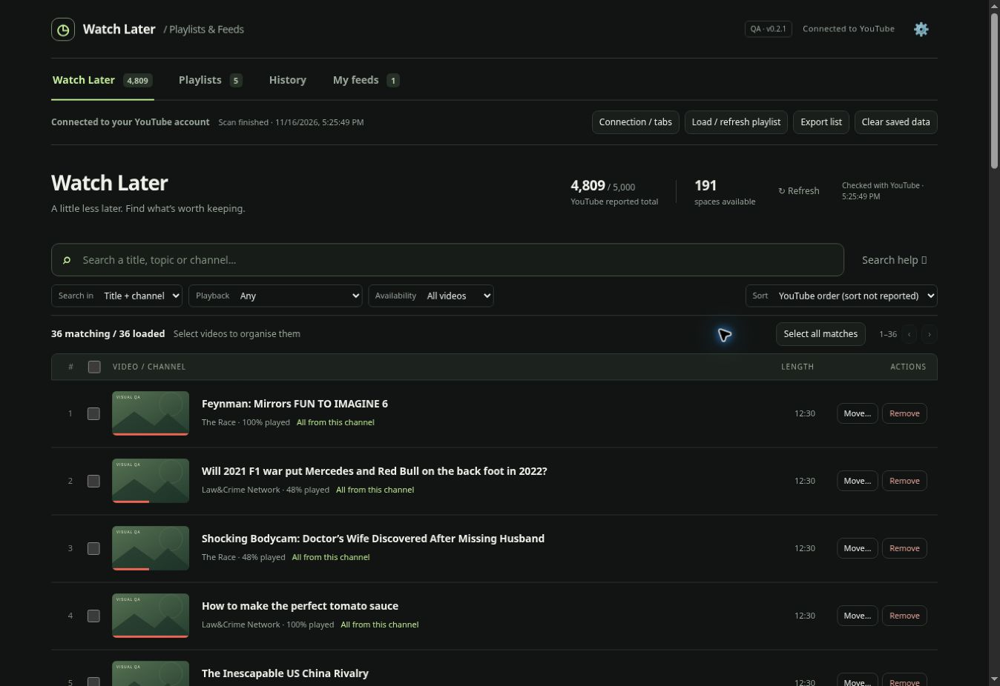

# Watch Later: YouTube Playlists & Feeds

Search your saved videos, organise playlists, restore removals, and build personal feeds from channels and categories.

**v0.2.2 is an experimental release candidate.** It uses YouTube's internal web endpoints, which can change without notice. Automated checks cover the main workflows; this release still needs verification against a real signed-in YouTube account. This is an independent project, not affiliated with YouTube or Google.

The v0.2.1 update restores the approved compact interface: counts beside the title, sticky search and selection tools, a selected-video drawer, compact playlist cards and the merged feeds/category view. The header displays the installed version.



## Install in Chrome

1. [Download watch-later-v0.2.2.zip](https://github.com/omahacrab/watch-later/raw/refs/heads/main/downloads/watch-later-v0.2.2.zip).
2. Extract the ZIP. Keep the extracted `watch-later` folder somewhere permanent.
3. Open `chrome://extensions` and enable **Developer mode**.
4. Choose **Load unpacked**, then select the folder that directly contains `manifest.json`. Do not select the ZIP or its outer download folder.
5. Click the extension's toolbar icon. Open YouTube, sign in, and connect. **Connection & settings** lets you choose a particular YouTube tab if several are open.
6. Load Watch Later. The extension reads every continuation page automatically. Keep the YouTube tab open while it works.

No Node.js, API key, paid service or build step is needed to use the downloaded extension.

**Updating an existing installation:** export removal history and feeds first, replace the files inside the same installed extension folder, then click **Reload** on its card at `chrome://extensions`. Reopen its page. Do not uninstall it or use a different folder if you want to retain its extension identity and local data. Existing v0.1.29 Watch Later caches and history use the same storage keys and are migrated into account-wide history when connected.

## Updates

The GitHub ZIP is an unpacked developer installation and does not update itself. Automatic updates for ordinary Windows/macOS Chrome users require a Chrome Web Store installation. An unlisted listing can distribute a testing version by direct link, and updates still go through store review. This project has not yet been published to the store.

See Chrome's [distribution guidance](https://developer.chrome.com/docs/extensions/how-to/distribute) and [update process](https://developer.chrome.com/docs/webstore/update).

## What you can do

- **Search and select:** filter as you type; quoted phrases, `title:`, `channel:`, exclusions and OR; comma-separated pills; persistent selections across searches; a selected-videos view; inclusive Shift-click ranges; sticky search and select-all; numbered rows and top/bottom pagination.
- **See playback:** thumbnails, reported played percentage, completed/partly played filters and a custom percentage range. Missing progress is labelled as missing, not assumed unwatched.
- **Organise playlists:** browse your editable playlists with counts; create private playlists; delete playlists with confirmation; inspect their videos; move or copy to several destinations. The arrow on the transfer button switches between Move and Copy. Creating a playlist can either select it for later or create and transfer immediately.
- **Clean up:** bulk removal and per-row removal, searchable removal history, individual/selected/all restores, and undo of the latest removal. Copies do not remove the source. Moves remove a source batch only after every destination has been checked.
- **Recover unavailable information:** select unavailable videos to reveal **Recover 'unavailable' info**. Recovery checks YouTube metadata and, with optional permission, the Internet Archive. It reports live counts and individual failures, and preserves recovered details in history. Recovery cannot make a deleted or private video playable.
- **Tag channels directly:** each channel row has a tag input. Comma, Enter or clicking away saves the tag and creates a saved feed if a matching single-category feed does not already exist. Existing tag names are suggested; × removes that channel’s assignment without deleting the shared tag or feed.
- **Build My feeds:** search YouTube for channels or discover them from loaded playlists; assign several categories to each channel; browse saved videos or recent channel uploads; combine categories and save the view as a feed. Save feed videos to Watch Later. Export/import feed definitions locally.

### Search examples

| Search | Result |
| --- | --- |
| `"the race"` | The exact phrase, without matching “disgrace” |
| `channel:"the race"` | Match the phrase in the channel name |
| `formula OR motogp` | Either term |
| `crime -trailer` | Crime, excluding trailer |
| `food,cooking` | OR pills for the two entries |

After typing a comma, the completed term becomes a pill and the whole list reappears. Typing the next term applies the combined OR search. Press Enter with an empty input to apply the existing pills immediately. Selections survive search changes.

## Behaviour and limits

- Mutations are sent in batches of **up to 500**. YouTube controls loading page sizes; requesting 500 mutation actions does not make playlist pages contain 500 entries. Actual acceptance of 500-item mutations requires live testing.
- The Watch Later capacity count is read separately from YouTube and refreshed after confirmed removals. Loaded entries and matches can differ from that count. Failed count reads are explicitly marked stale.
- YouTube's offered sort commands are used when present. Local title, channel and duration sorts are also available. The extension does not invent “date added” timestamps. Upload ordering in feeds estimates dates from YouTube's relative labels where available.
- Recent-upload feeds use a channel's returned **Videos** tab. They are loaded on demand, not continuously in the background. Shorts-only/live-only channels, unrecognised response layouts, and missing channel IDs are reported rather than silently treated as empty channels.
- YouTube sometimes hides unavailable entries, omits metadata, delays newly added videos, or rate-limits reads. Interrupted mutations are reconciled by reading the playlist. Unknown formats stop the operation rather than implying success. Retry after YouTube is reachable again if automatic reconciliation cannot complete.
- Playlist discovery uses YouTube's Save menu and requires an available video in the active playlist or Watch Later. An entirely empty account may need one available video saved before discovery works; creating a playlist is still available.
- Restoring adds available videos back to their original playlist, skipping IDs already present. Original positions are not retained. A deleted playlist must be recreated separately; playlist deletion is not undoable through video history.
- Data belongs to the connected YouTube account and the installed Chrome profile. There is no server sync, paid AI categorisation, anonymous analytics or community contribution service in this version.

See [feature scope](docs/FEATURE_SCOPE.md), [validation and live-test checklist](docs/VALIDATION.md), [release notes](docs/RELEASE_NOTES.md) and [privacy details](PRIVACY.md).

## Development

Requires Node.js 22 or later and Python 3 for packaging.

```sh
npm ci
npm run check
npm test
npm run package
```

Runtime code has no external dependencies. `linkedom` is used only by the development checks and DOM workflow tests. The ZIP contains an explicit allowlist of runtime files and user documentation, excluding tests and development dependencies.

CI repeats these checks and produces an installation artifact. A `v*` tag can create a GitHub prerelease through the release workflow. The checked-in download under `downloads/` is usable immediately without waiting for a tagged release.

## Reporting problems

Open an issue with your Chrome version, extension version, the action you attempted, and the visible error. Please do not attach cookies, authorization headers, full network requests or private playlist exports publicly. Redact private titles and account details from screenshots. Format diagnostics in the export contain response structure, not authentication values, but the export also contains your playlist data.

## License

MIT. See [LICENSE](LICENSE).
